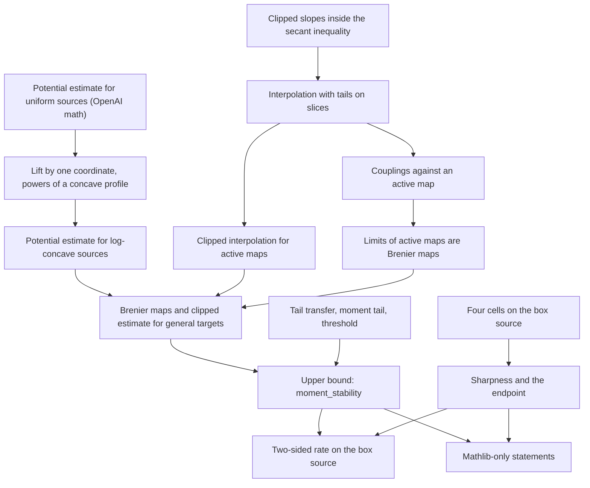

# Proof outline and entry points

The target is the stability of Brenier maps from a log-concave source on a bounded convex set,
when one target has a power-logarithmic moment at most one and the other has finite second
moment, together with the sharpness of the resulting modulus.

1. **Potentials for uniform sources.** `UniformBase` runs the chain of OpenAI math for finite
   targets with common masses and returns the intercepts and the active maps:
   `atomicPotentialBound_uniform`, with the constant `√326 R`. `PotentialBound` holds the
   explicit form `AtomicPotentialBound` and its descent to a marginal.
2. **Potentials for log-concave sources.** `LastCoordinate` splits off one coordinate and
   describes the region under a concave graph. `PowerSource` proves the estimate for densities
   `h ^ r` by induction on `r`. `PotentialBoundLimit` passes to a limit in total variation, and
   `LogConcave` approximates `exp (-V)` by `(1 - V / n) ^ n`:
   `atomicPotentialBound_logConcave`.
3. **Interpolation with tails.** `Clip` and `ClipSlack` contain the pointwise inequality for
   clipped slopes. `LineInterpolation` integrates it on a line, `CoordSlices` by slices, and
   `SourceInterpolation` for the weighted source. `StripInterpolation` states the result as a
   property of the source, `stripInterpolation_logConcave`. `ActiveMaps` applies it to two
   active maps: `clipped_interpolation_of_active`.
4. **Brenier maps for targets with finite second moment.** `PlanComparison` compares a coupling
   with an active map through its conditional kernel. `LimitCertificate` shows that a limit of
   active maps is the unique optimal map onto its law. `FiniteTargets` treats finite targets and
   `GeneralTargets` the limit: `exists_limit_map`, `clipped_estimate_of_limits`.
5. **The rate.** `Tails`, `MomentTail`, `Threshold` and `OneSided` are scalar:
   `rate_of_interpolation`. `MomentStability` assembles the theorem for a source with the two
   properties of steps 2 and 3 (`moment_stability_of_goodSource`), and `UpperBound` proves
   `moment_stability`.
6. **Sharpness.** `FourCellGeometry`, `FourCellSlices` and `CoordBox` describe the four cells and
   their masses. `FourAtomSharp` proves optimality, the distance of the targets and the lower
   bound for the maps. `SharpRate` fixes the parameters, and `Sharpness` proves
   `moment_rate_sharp` and `no_modulus_at_second_moment`. `TwoSided` adds the upper bound on the
   box source: `moment_rate_two_sided`.
7. **Public presentation.** `Presentation/Model` defines the Mathlib-only vocabulary and
   `FCPresentation` derives the three public statements.

All paths above are modules under [`../lean/BrenierMoment/`](../lean/BrenierMoment/).
The [dependency ledger](../lean/blueprint/dependencies.json) records audited Lean
declarations as witnesses. Three of its nodes are conditional: their statements carry the
estimate for uniform sources as a hypothesis, which `UniformBase` supplies before the final
theorem is assembled.
